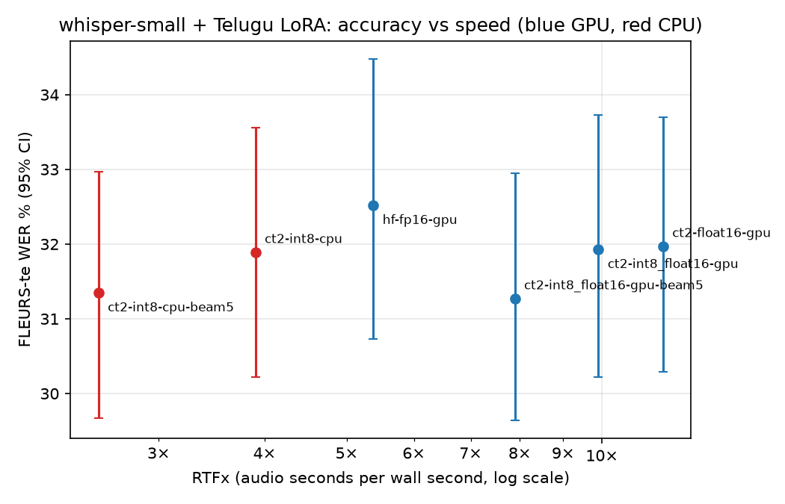

# whisper-telugu

LoRA fine-tuning of `openai/whisper-small` for Telugu ASR, scored with a Telugu-safe text normaliser and bootstrap confidence intervals, then exported to CTranslate2 (faster-whisper) at FP16 / INT8 and benchmarked for latency against accuracy on an RTX 4060 Laptop GPU and a laptop CPU.

Every number below comes from a CSV in `results/`; the tables are printed by `make_tables.py`.

## Results

LoRA on 5.1% of the parameters takes whisper-small from unusable to **32.4% WER on FLEURS Telugu** (95% CI 30.7–34.3%) and **32.7% on Kathbath** (31.8–33.5%), with CER of 9.8% and 6.5%. Converted to CTranslate2, it runs 2.2× faster than Transformers on the GPU, and the INT8 build runs at 3.9× real time on a laptop CPU in 308 MB with no measurable loss in accuracy.

### WER and CER, Telugu-safe normaliser (`norm_te`)

| Model | FLEURS-te WER (95% CI) | FLEURS-te CER | Kathbath-te WER (95% CI) | Kathbath-te CER |
| --- | --- | --- | --- | --- |
| whisper-small, zero-shot | 154.2% (139.8%–170.6%) | 164.6% | 143.2% (135.0%–151.2%) | 223.9% |
| + LoRA, 2k steps | 44.2% (41.9%–46.9%) | 13.8% | 44.4% (43.6%–45.3%) | 9.9% |
| **+ LoRA, 4k steps (selected)** | **32.4% (30.7%–34.3%)** | **9.8%** | **32.7% (31.8%–33.5%)** | **6.5%** |

Zero-shot whisper-small does not transcribe Telugu: about three quarters of its outputs are repetition loops that run to the 448-token limit, and over half are mostly in Kannada script, so insertions push WER above 100%.

### Same outputs, Whisper's `BasicTextNormalizer`

| Model | FLEURS-te WER (95% CI) | FLEURS-te CER | Kathbath-te WER (95% CI) | Kathbath-te CER |
| --- | --- | --- | --- | --- |
| whisper-small, zero-shot | 197.7% (189.2%–207.0%) | 145.3% | 267.6% (262.5%–272.2%) | 208.7% |
| + LoRA, 2k steps | 19.3% (17.9%–20.9%) | 11.6% | 15.3% (14.9%–15.8%) | 7.3% |
| + LoRA, 4k steps (selected) | 13.3% (12.0%–14.8%) | 8.0% | 10.0% (9.7%–10.4%) | 4.6% |

These lower numbers are not better accuracy. The default normaliser turns every vowel sign and virama into a space, so one Telugu word becomes several short fragments that are easy to match. They are here only for comparison with model cards that used the default; quote the `norm_te` table.

### Checkpoint selection (val)

| Checkpoint | val WER (95% CI) | val CER |  |
| --- | --- | --- | --- |
| lora-1k | 49.0% (46.6%–51.5%) | 12.5% |  |
| lora-2k | 40.5% (38.3%–42.5%) | 9.4% |  |
| lora-3k | 32.6% (30.5%–34.8%) | 7.0% |  |
| lora-4k | 28.1% (26.2%–30.0%) | 5.9% | selected |

The checkpoint was chosen on `val` only (`results/checkpoint_selection.csv`); the test sets were scored once per reported model. WER was still falling steeply at the last checkpoint, so the 4k model is not converged.

### Where the errors are (4k model, `results/breakdown/`)

- **Seen vs unseen speakers.** Kathbath's `valid` split shares 10 of its 20 speakers with the Kathbath train shards. On those speakers WER is 29.0%; on the 10 unseen speakers it is **37.0%**. The unseen figure is the honest Kathbath number for new voices. FLEURS test, the official held-out split, is the headline benchmark.
- **Speakers.** On Kathbath, 9 of 20 speakers carry half the errors, and per-speaker WER ranges from 20.7% to 46.6%.
- **Spelling variants.** 79 of the 115 top-20 Kathbath substitutions (17 of 65 on FLEURS) are orthographic variants of the same word: తరువాత/తర్వాత, కాని/కానీ, చేసాడు/చేశాడు. Part of the WER reflects inconsistent spelling in the references, not mishearing.
- **Numbers and Latin script.** FLEURS references write digits and Latin abbreviations ("2", "km", "000"), while the model writes them out in Telugu (రెండు, మీ, వేల). 64% of number tokens and 92% of Latin-script tokens are wrong, against 28% of Telugu words. Kathbath has neither.
- **Clip length.** On FLEURS, WER is flat at 28–33% up to 20 s and rises to 43% on the 8 clips over 20 s, driven by deletions (19%): long clips get cut short.

### Deployment: accuracy vs speed (FLEURS-te test, 471 clips)

The selected adapter is merged into whisper-small and converted to CTranslate2 at three precisions, then run with faster-whisper one clip at a time (batch 1, one warm-up clip, latency per clip).

| Configuration | Device | Beam | WER (95% CI) | p50 / p95 latency (ms) | RTFx | Peak memory | Size on disk |
| --- | --- | --- | --- | --- | --- | --- | --- |
| hf-fp16-gpu | RTX 4060 Laptop | 1 | 32.5% (30.7%–34.5%) | 1911 / 3406 | 5.4 | 710 MB | 461 MB |
| ct2-float16-gpu | RTX 4060 Laptop | 1 | 32.0% (30.3%–33.7%) | 886 / 1479 | 11.8 | 854 MB | 461 MB |
| ct2-int8_float16-gpu | RTX 4060 Laptop | 1 | 31.9% (30.2%–33.7%) | 1042 / 1862 | 9.9 | 583 MB | 233 MB |
| ct2-int8_float16-gpu-beam5 | RTX 4060 Laptop | 5 | 31.3% (29.6%–33.0%) | 1321 / 2333 | 7.9 | 662 MB | 233 MB |
| ct2-int8-cpu | cpu | 1 | 31.9% (30.2%–33.6%) | 2666 / 4346 | 3.9 | 308 MB | 233 MB |
| ct2-int8-cpu-beam5 | cpu | 5 | 31.4% (29.7%–33.0%) | 4007 / 7397 | 2.5 | 469 MB | 233 MB |



- **CTranslate2 is 2.2× faster than Transformers at no accuracy cost**: 11.8× vs 5.4× real time on the GPU, with median latency down from 1.9 s to 0.9 s per clip, and WER within the confidence interval (32.0% vs 32.5%).
- **INT8 costs nothing measurable.** int8_float16 scores 31.9% against 32.0% for float16, at half the size on disk (233 MB vs 461 MB) and 32% less peak GPU memory (583 MB vs 854 MB). On this GPU it is slightly slower than float16 (9.9× vs 11.8×).
- **A laptop CPU is enough.** INT8 on 8 threads of a Ryzen 7 7840HS runs at 3.9× real time in 308 MB with the same 31.9% WER, so the model is deployable without a GPU.
- **Beam search is not worth it here.** Beam 5 lowers WER by about half a point (31.3% GPU, 31.4% CPU), inside the confidence interval, for 20–35% less throughput.
- **CTranslate2 4.8.3 truncates long Telugu outputs by default.** It generates only `max_length / 2` tokens (224 of 448), and Telugu costs several byte-level tokens per word, so 103 of 471 FLEURS transcripts came out at least 20% shorter than Transformers', many cut mid-word, and WER read 42.0% before the fix. `bench.py` asks for twice the length and keeps decoding inside Whisper's 448 positions; after that, float16 output matches Transformers on the clips checked.

Peak memory is the increase over the idle baseline: GPU memory from `nvidia-smi` (which includes the CUDA context), or process RSS on CPU. Clocks were not locked, and the laptop was in normal use, so latencies are indicative rather than lab-grade. The Transformers row reads 32.5% here against 32.4% in `evaluate.py`, probably because it decodes one clip at a time instead of in padded batches of 16.

## Pipeline

| Step | Script | Output |
| --- | --- | --- |
| 1. Load, clean, resample to 16 kHz, split | `data/prepare.py` | `$WT_DATA/{train,val,test_fleurs,test_kathbath}`, `results/data_stats_<dir>.csv` |
| 2. Zero-shot baseline | `evaluate.py --name zeroshot` | `results/wer.csv`, `results/preds/` |
| 3. LoRA fine-tuning | `train_lora.py` | `$WT_WORK/ckpt/whisper-small-te-lora/` |
| 4. Checkpoint selection, WER/CER with 95% CIs, breakdowns | `evaluate.py`, `analyze.py` | `results/wer.csv`, `results/checkpoint_selection.csv`, `results/breakdown/` |
| 5. Merge, convert, benchmark | `export_ct2.py`, `bench.py` | `results/bench.csv`, `results/wer_vs_rtfx.png` |

## Training

| Setting | Value |
| --- | --- |
| Base model | `openai/whisper-small` (242M parameters) |
| LoRA | r = 32, alpha = 64, dropout 0.05, on `q_proj, k_proj, v_proj, out_proj, fc1, fc2` in encoder and decoder |
| Trainable parameters | 12,976,128 (5.09%) |
| Optimisation | AdamW, lr 1e-3, 100 warm-up steps, linear decay, batch 8 × 2 accumulation, FP16, gradient checkpointing |
| Steps | 4,000 (2.7 epochs over 46.9 h of audio) |
| Augmentation | SpecAugment time masking (`mask_time_prob` 0.05) |
| Hardware | RTX 4060 Laptop (8 GB), WSL2; about 5 h of training |

The run was resumed from its last checkpoint (`--resume`) three times: once after a `CUDA error: unknown error` fault on the laptop GPU, and twice after the process was killed under host memory pressure. Resuming restores the optimiser, scheduler, RNG and data order, so the result is the same 4,000-step run.

## Reproduce

Inside WSL2 Ubuntu, with data and checkpoints on the Linux filesystem (`WT_WORK`, default `~/wt`):

```bash
python3 -m venv ~/venvs/wt && source ~/venvs/wt/bin/activate
pip install -r requirements.txt
hf auth login                                   # Kathbath is gated: accept its terms first
export WT_DATA=~/wt/data_kb                     # one directory per data mix

./run.sh python data/prepare.py                 # FLEURS + OpenSLR 66 (in ~/wt/raw/slr66) + 8 Kathbath shards
./run.sh python evaluate.py --name zeroshot
./run.sh python train_lora.py --overfit 32 --max_steps 200 --out ~/wt/ckpt/overfit   # pipeline check
./run.sh python train_lora.py                   # add --resume to continue after a crash

CK=~/wt/ckpt/whisper-small-te-lora
for k in 1 2 3; do ./run.sh python evaluate.py --name lora-${k}k --adapter $CK/checkpoint-${k}000 --splits val; done
./run.sh python evaluate.py --name lora-4k --adapter $CK/final --splits val
# pick the lowest val WER (here lora-4k), then score it and lora-2k on the test sets
./run.sh python evaluate.py --name lora-2k --adapter $CK/checkpoint-2000
./run.sh python evaluate.py --name lora-4k --adapter $CK/final
./run.sh python analyze.py results/preds/lora-4k_test_fleurs.csv results/preds/lora-4k_test_kathbath.csv
./run.sh python export_ct2.py --adapter $CK/final
./run.sh python bench.py --configs hf-fp16-gpu,ct2-float16-gpu,ct2-int8_float16-gpu,ct2-int8_float16-gpu-beam5,ct2-int8-cpu,ct2-int8-cpu-beam5
./run.sh python make_tables.py
```

`run.sh` activates the venv, sets `WT_WORK` and puts the pip-installed cuBLAS/cuDNN on `LD_LIBRARY_PATH` for faster-whisper.

## Scoring: why a custom normaliser

Whisper's `BasicTextNormalizer` replaces every Unicode character in category M with a space. Telugu vowel signs and the virama are category M, so it splits words into fragments and the WER stops meaning anything. `common.norm_te` applies NFC, drops zero-width joiners and strips only punctuation (P) and symbols (S). Every WER here is reported with both normalisers (`normaliser` column in `results/wer.csv`), so a gain cannot be a normalisation artefact.

WER confidence intervals are 95% percentile bootstraps over utterances (1,000 resamples).

## Data

| Dataset | Licence | Use |
| --- | --- | --- |
| [FLEURS](https://huggingface.co/datasets/google/fleurs) `te_in` | CC-BY-4.0 | train + validation for training; **test = headline benchmark** |
| [OpenSLR 66](https://openslr.org/66) | CC BY-SA 4.0 | training |
| [Kathbath](https://huggingface.co/datasets/ai4bharat/Kathbath) (AI4Bharat) | CC-BY-4.0 | training (first 8 train shards); its `valid` split is the second benchmark, since the test split is not on the Hub |

| Split | FLEURS | OpenSLR 66 | Kathbath | Total |
| --- | --- | --- | --- | --- |
| train | 2,575 clips, 8.7 h | 4,403 clips, 5.7 h | 16,914 clips, 32.7 h | 23,871 clips, 46.9 h (21 clips with labels over 448 tokens dropped) |
| val | 33 | 45 | 222 | 300 clips |
| test | 471 clips, 1.4 h | – | 2,379 clips, 5.0 h, 20 speakers | |

`val` (300 clips) is a random slice of the training pool, used only to choose checkpoints. Neither test set is trained on or used for selection.

## Limitations

- **Not converged.** Val WER fell by 4.5 points between the 3k and 4k checkpoints; a longer run would probably do better.
- **Kathbath speaker overlap.** Half of the Kathbath benchmark speakers are in the training data (see above), so the headline Kathbath WER is optimistic; the unseen-speaker figure (37.0%) is the fair one.
- **Optimistic val.** `val` is drawn from the training pool, so it shares speakers with training and reads lower than test (28.1% vs 32.4% on FLEURS). It is used only to rank checkpoints.
- **Spelling variation counts as error.** No orthographic normalisation beyond NFC and punctuation; variant spellings and digits vs number words are scored as wrong.
- **One run.** A single seed and a single hyperparameter setting; the confidence intervals cover test-set sampling, not training variance.
- **No external comparison.** Published Telugu whisper-small numbers do not state their normaliser, so no head-to-head claim is made here.
- **Clips up to 30 s only.** Long-form audio (chunking or VAD) is not evaluated.
